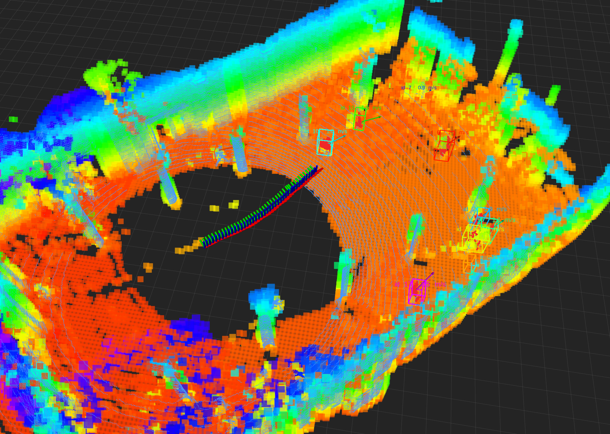
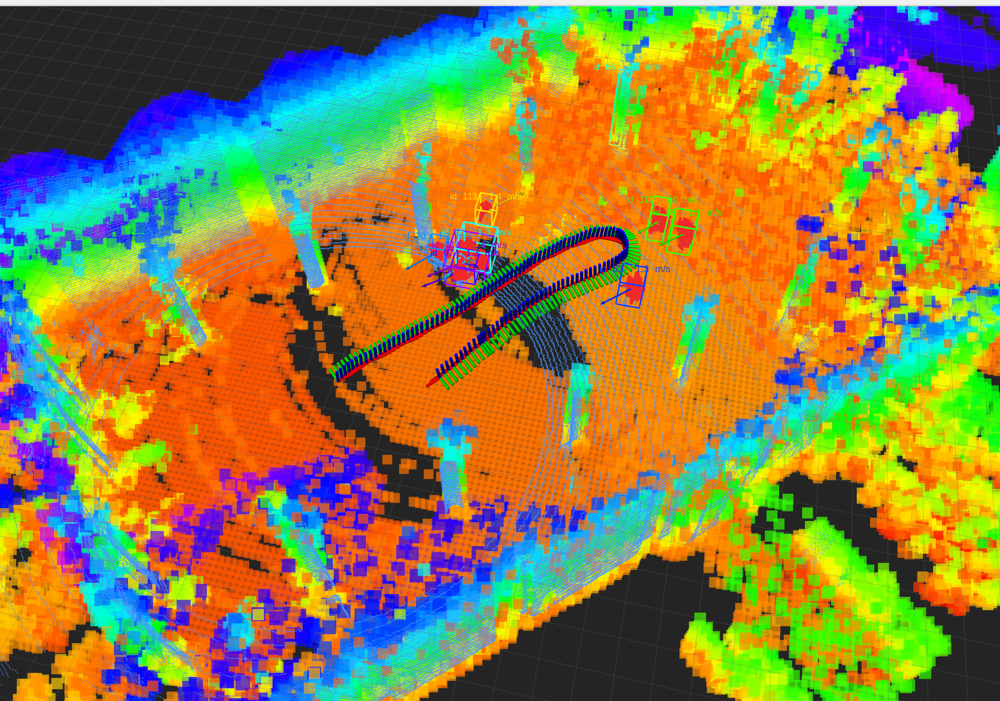

# raycast_static_map

A real-time ROS1 (Noetic) sparse voxel mapper for LiDAR. The node synchronizes registered point clouds with odometry, performs 3D DDA ray-casting with log-odds occupancy fusion and a truncated ESDF, and optionally removes dynamic obstacles with a Dynablox-style ever-free test. The occupancy criterion can be switched with `use_tsdf` between a log-odds probability threshold and a truncated signed distance field. Detected dynamic clusters are associated across frames and **tracked with a constant-velocity Kalman filter** to estimate velocity and predict future positions.

Key highlights: the node **publishes both a truncated ESDF and a TSDF alongside the occupancy value for every voxel** (`x/y/z/occupancy/esdf/tsdf`), ready for planning, collision checking and occupancy-based learning.



*RViz: sparse occupancy voxels colored by height, the LiDAR trajectory, and tracked dynamic objects shown as wireframe boxes with per-id colors, an id/speed label, a velocity arrow and a predicted-position sphere. Tracking runs a constant-velocity Kalman filter per object.*

## Table of contents

- [Features](#features)
- [Pipeline](#pipeline)
- [Relation to ETH-ASL Dynablox](#relation-to-eth-asl-dynablox)
- [Topics and outputs](#topics-and-outputs)
- [Build](#build)
- [Quick start](#quick-start)
- [Parameters](#parameters)
- [Dynamic objects](#dynamic-objects)
- [Examples](#examples)
- [Troubleshooting](#troubleshooting)
- [Data and ROS bags](#data-and-ros-bags)
- [Repository layout](#repository-layout)
- [License](#license)

## Features

- **Sparse hash voxel map**: only observed voxels are allocated, so memory grows with observations rather than with the explored volume.
- **3D DDA ray-casting**: after deduplicating endpoint voxels a single traversal is performed; endpoints update occupied, intermediate voxels update free.
- **Switchable occupancy criterion**: `use_tsdf=false` uses the fused log-odds probability threshold; `use_tsdf=true` uses the TSDF signed distance. Both share the same probability state, so the criterion can be switched at any time.
- **Publishes both ESDF and TSDF**: every voxel in `~occupied_voxels` / `~known_voxels` carries `x/y/z/occupancy/esdf/tsdf`.
  - **ESDF**: truncated Euclidean distance obtained by multi-source propagation from all occupied voxels; the ESDF of free voxels is directly usable for planning and collision checking.
  - **TSDF**: projective truncated signed distance fused along each ray (positive = free, negative = behind the surface); voxels never observed report `+tsdf_truncation`.
- **Dynablox-style dynamic removal**: an ever-free high-confidence free-space map plus dynamic seed clustering; dynamic objects are not written into the static map.
- **Dynamic object tracking**: AABB bounding boxes + constant-velocity Kalman filter (smoothed position/velocity) + velocity prediction.
- **RViz visualization**: wireframe bounding boxes, per-object colors, velocity arrows and predicted-position spheres.
- **Regression tests**: `gtest` covering ray-casting/ESDF, the TSDF criterion and carving, dynamic classification and Kalman tracking.

## Pipeline

- The map is a `std::unordered_map<VoxelKey, Cell>`; only observed voxels are allocated. Each cell stores log-odds, free-observation count, occupancy history, the ever-free flag, the nearest-obstacle index, the ESDF distance and the TSDF value/weight.
- Per frame, endpoint voxels are deduplicated and each ray is traced once: endpoints update occupied, intermediate voxels update free.
- **Occupancy criterion** (`use_tsdf`):
  - `false` (default): `occupied = log_odds >= logit(occupied_probability)`.
  - `true`: the projective signed distance `d_surface - projection` is fused per voxel as a weighted average, and `occupied = tsdf_observed && tsdf <= tsdf_surface_band`.
  - The log-odds update always runs, so the criterion can be switched at any time. Rays of dynamic points never write the TSDF.
  - **Free-space carving**: a voxel clearly in front of the measured surface (`signed_distance > tsdf_truncation`) that was previously fused as a surface is cleared. Without this, stale dynamic surfaces stay occupied and poison the ever-free test.
- The ESDF is produced by multi-source propagation from all occupied voxels, so it follows the active criterion. `esdf_update_every_n_frames` sets the update interval.
- Dynamic detection follows Dynablox: points falling into historical ever-free space become dynamic seeds, are clustered, and are excluded from static fusion. Persistently re-observed objects are re-admitted as static after `ever_free_reset_occupied_frames`.

## Relation to ETH-ASL Dynablox

The dynamic pipeline deliberately mirrors [ethz-asl/dynablox](https://github.com/ethz-asl/dynablox).

| Dynablox | This package | Default |
|---|---|---|
| `temporal_buffer` | `ever_free_temporal_buffer_frames` | 2 |
| `counter_to_reset` | `ever_free_reset_occupied_frames` | 150 |
| `burn_in_period` | `ever_free_burn_in_period` | 5 |
| `neighbor_connectivity` (ever-free) | `ever_free_neighbor_connectivity` | 26 |
| `tsdf_occupancy_threshold` | `tsdf_surface_band` | 0.3 |
| `truncation_distance` | `tsdf_truncation` | 0.4 |
| `max_weight` | `tsdf_max_weight` | 1000 / 30 |
| `min`/`max_cluster_size` | `cluster_min_points` / `cluster_max_points` | 20 / 200000 |
| `min`/`max_extent` [m] | `cluster_min_extent` / `cluster_max_extent` | 0 / 200000 |
| `neighbor_connectivity` (cluster) | `cluster_connectivity` | 6 |
| `grow_clusters_twice` | `cluster_grow_clusters_twice` | false |
| `min_cluster_separation` | `cluster_min_separation` | 0.2 |

Differences: Dynablox uses a voxblox block TSDF, while this package uses sparse hash voxels with a selectable probability or TSDF criterion; this package adds free-space carving and does object-level (tracking) labeling in the node rather than in the core detector.

To match the original voxblox settings (`voxel_size 0.2, truncation 0.4`):

```yaml
use_tsdf: true
tsdf_truncation: 0.4
tsdf_surface_band: 0.3
```

## Topics and outputs

Node name `raycast_static_map`; all topics live in its private namespace.

| Topic | Type | Description |
|---|---|---|
| `~occupied_voxels` | `sensor_msgs/PointCloud2` (latched) | Occupied voxel centers, fields `x/y/z/occupancy/esdf/tsdf` |
| `~known_voxels` | `sensor_msgs/PointCloud2` (latched) | All allocated voxels, same fields; free-voxel ESDF is ready for planning |
| `~static_points` | `sensor_msgs/PointCloud2` | Static points of the current frame (world frame) |
| `~dynamic_points` | `sensor_msgs/PointCloud2` | Dynamic points of the current frame (world frame) |
| `~dynamic_objects` | `visualization_msgs/MarkerArray` | Tracked objects (wireframe box + id/speed text + velocity arrow + prediction sphere) |
| `~occupancy_grid` | `nav_msgs/OccupancyGrid` (latched) | 2D occupancy projection within a height band |
| `~reset` | `std_srvs/Empty` (service) | Clears occupancy, ever-free, ESDF and tracking state |

Published fields:

| Field | Meaning |
|---|---|
| `occupancy` | Fused occupancy probability |
| `esdf` | Truncated Euclidean distance to the nearest occupied voxel [m], capped by `esdf_max_distance` |
| `tsdf` | Fused truncated signed distance [m]; positive = free, negative = behind the surface; never-observed voxels report `+tsdf_truncation` |

## Build

Requires Ubuntu 20.04 + ROS Noetic, `visualization_msgs`, PCL (common) and Eigen3.

```bash
cd <your_catkin_ws>
catkin_make -DCMAKE_BUILD_TYPE=Release
source devel/setup.bash
catkin_make run_tests_raycast_static_map_gtest_test_raycast_mapper
```

## Quick start

The node subscribes to a registered point cloud and odometry (FAST-LIO defaults: `/cloud_registered`, `/Odometry`).

```bash
roslaunch raycast_static_map fastlio_raycast.launch                      # probability criterion + Dynablox + tracking
roslaunch raycast_static_map fastlio_raycast.launch use_tsdf:=true       # TSDF occupancy criterion
roslaunch raycast_static_map fastlio_raycast.launch use_dynablox:=false  # disable dynamic removal
roslaunch raycast_static_map fastlio_raycast.launch use_tracking:=false  # disable tracking
roslaunch raycast_static_map fastlio_raycast.launch input_cloud_in_world:=false  # raw sensor-frame cloud
```

FAST-LIO already outputs in the `camera_init` world frame, so `input_cloud_in_world:=true` is the default. If odometry reports the body rather than the LiDAR pose, set `sensor_extrinsic_translation` and `sensor_extrinsic_rpy`.

## Parameters

The full annotated list is in `config/fastlio.yaml` (DOALS example: `config/doals_hauptgebaeude.yaml`). All parameters can be overridden with `<rosparam>`.

| Group | Key parameters (default) |
|---|---|
| IO / sync | `cloud_topic` (`/cloud_registered`), `odom_topic` (`/Odometry`), `map_frame` (`camera_init`), `input_cloud_in_world` (`true`), `sync_tolerance` (`0.05`) |
| Map | `resolution` (`0.20`), `min_range`/`max_range` (`1.0`/`80.0`), `prob_hit`/`prob_miss` (`0.70`/`0.40`), `occupied_probability` (`0.60`) |
| TSDF | `use_tsdf` (`false`), `tsdf_truncation` (`0.60`), `tsdf_surface_band` (`0.10`), `tsdf_max_weight` (`30.0`) |
| ESDF | `esdf_max_distance` (`5.0`), `esdf_update_every_n_frames` (`1`) |
| Dynamic removal | `use_dynablox` (`true`), `dynamic_z_use_map_frame` (`false`), `dynamic_z_min`/`dynamic_z_max` (`-2.0`/`2.5`), `ever_free_burn_in_period` (`5`), `ever_free_temporal_buffer_frames` (`2`), `ever_free_reset_occupied_frames` (`150`), `ever_free_max_free_probability` (`0.0`) |
| Clustering | `cluster_connectivity` (`6`), `cluster_min_points`/`cluster_max_points` (`20`/`200000`), `cluster_min_extent`/`cluster_max_extent` (`0`/`200000`) |
| Tracking | `use_tracking` (`true`), `track_max_association_distance` (`1.0`), `track_min_track_duration` (`2`), `track_max_misses` (`5`), `track_kalman_process_noise` (`2.0`), `track_kalman_measurement_noise` (`0.5`), `track_velocity_horizon` (`1.0`) |
| Output | `publish_every_n_frames` (`1`), `publish_known_voxels` (`true`), `publish_2d_grid` (`true`), `grid_z_min`/`grid_z_max` (`-1.0`/`2.0`) |

## Dynamic objects

Pipeline: the mapper emits clusters (centroid + AABB) → `ObjectTracker` associates them across frames → velocity estimation and prediction → RViz MarkerArray.

- **Clustering / bounding boxes**: Dynablox-style clustering yields, per cluster, the point count, centroid and axis-aligned bounding box.
- **Tracking**: greedy nearest-neighbour association against the Kalman prediction with gate `track_max_association_distance`; a track is confirmed after `track_min_track_duration` observations and dropped after `track_max_misses` consecutive misses.
- **Velocity**: a constant-velocity Kalman filter (state `[p, v]`, measurement = centroid) estimates a smoothed position and velocity, with process noise `track_kalman_process_noise` and measurement noise `track_kalman_measurement_noise`.
- **Prediction**: `p_pred = p + v * track_velocity_horizon`.
- **Visualization**: per object a wireframe box (`LINE_LIST`), a text label (`id N  v m/s`), a velocity arrow and a prediction sphere, each with a distinct per-id color.

## Examples



*Close-up of a tracked dynamic object: wireframe bounding box, id/speed label, velocity arrow and predicted-position sphere produced by the Kalman filter.*

Run the DOALS Hauptgebaeude sequence 1 example (see [Data and ROS bags](#data-and-ros-bags) for how to obtain and convert the bag):

```bash
roslaunch raycast_static_map doals_validation.launch rviz:=true
rosbag play $(rospack find raycast_static_map)/data/doals_hauptgebaeude_sequence_1/sequence_1.bag --rate 0.5
```

## Troubleshooting

Ever-free detection fails on **grazing surfaces**, which is the most common source of false dynamics:

- **Flat facades** (e.g. shop fronts): oblique rays graze the surface, so its log-odds oscillates around the threshold and the voxel is briefly labeled ever-free, then seeded as dynamic. Use the TSDF criterion (`use_tsdf: true`, `tsdf_surface_band ≈ 1.5 × resolution`), or add a free margin with `ever_free_max_free_probability: 0.2` in probability mode.
- **Ground rings**: a shallow ray travels a long way inside the same ground-level voxel layer before hitting the ground, creating an ever-free layer that ground returns fall into. Raise `ever_free_burn_in_period`, raise `dynamic_z_min`, use a map-frame height band (`dynamic_z_use_map_frame: true`), or shorten `max_range`.

Note: `dynamic_z_min/dynamic_z_max` are interpreted in the **sensor frame** by default; set `dynamic_z_use_map_frame: true` to filter in map height instead. To reject small clusters, prefer `cluster_min_points` (distance-independent) over `cluster_min_extent` (AABB minimum edge, in meters).

## Data and ROS bags

No datasets or bags are tracked (`.bag`, `.db3`, `.mcap`, `.pcd`, `.bin` are ignored); `data/` only keeps a `.gitkeep`. The example uses DOALS Hauptgebaeude sequence 1, converted to `data/doals_hauptgebaeude_sequence_1/sequence_1.bag`:

```bash
rosrun raycast_static_map converted_sequence_to_bag.py <converted_sequence_dir> \
  $(rospack find raycast_static_map)/data/doals_hauptgebaeude_sequence_1/sequence_1.bag
```

Run mapping with RViz, then replay the bag (start the node first):

```bash
roslaunch raycast_static_map doals_validation.launch rviz:=true
rosbag play $(rospack find raycast_static_map)/data/doals_hauptgebaeude_sequence_1/sequence_1.bag --rate 0.5
rosrun raycast_static_map check_mapping_output.py   # validates fields and value ranges
```

Both dynamic removal and tracking require a temporally continuous sequence. Measurement results are recorded in `VALIDATION.md`.

## Repository layout

```text
raycast_static_map/
├── config/        fastlio.yaml, doals_hauptgebaeude.yaml
├── include/raycast_static_map/   raycast_mapper.hpp, dynamic_object.hpp, object_tracker.hpp
├── src/           raycast_mapper.cpp, object_tracker.cpp, raycast_static_map_node.cpp
├── launch/        fastlio_raycast.launch, doals_validation.launch
├── rviz/          doals_mapping.rviz
├── scripts/       converted_sequence_to_bag.py, check_mapping_output.py
├── test/          test_raycast_mapper.cpp
├── imgs/          mapping_overview.png, dynamic_tracking.png
├── data/          not tracked (only .gitkeep)
├── CMakeLists.txt, package.xml, README.md, VALIDATION.md
```

- `RaycastMapper` — ray-casting, log-odds/TSDF criteria, ESDF, Dynablox dynamic removal and clustering.
- `ObjectTracker` — data association, constant-velocity Kalman filter, velocity prediction.
- ROS node — cloud/odometry sync, frame transforms, topic publication, RViz markers.

## License

BSD-3-Clause. The dynamic detection approach is inspired by [ethz-asl/dynablox](https://github.com/ethz-asl/dynablox) (BSD-3-Clause); this implementation is an independent rewrite.
